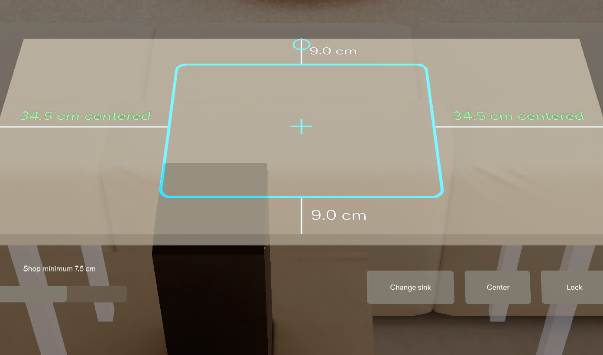

# Measure Twice

A SPECS Lens for the moment before an irreversible cut: it lays a sink cutout outline at real size on a vanity top blank, writes the distance to each edge on the stone, flags a rail thinner than the shop allows, and then walks you through the pencil marks corner by corner, with the pencil and square still in your hands.

Built for [Learn AR with SPECS](https://learn-specs.devpost.com/) Round 2 by Design Master Solutions LLC, the team behind Stone Project, a marketplace for fabricators' stone remnants.

Status: built on 17 Nov 2026 from `devpost/design-brief.md` by Snap's CLAD agents through the Lens Studio MCP (planned with the Devpost Learn `plan-lens` skill pack). LEAF: 7/7 done criteria pass in the preview; see `docs/build-report.md` and `docs/prints/`. Runs in the Lens Studio preview only; nothing here has been tried on SPECS glasses.

Demo video (2:20, screen recording of the Lens Studio preview, narrated in my own voice): https://youtu.be/T8egJbTyp-k

## Who it is for

Stone fabricators and installers laying out an undermount sink cutout on a vanity top. Today that layout is a paper template taped to the slab and a tape measure checked several times, because a cutout in the wrong place scraps the piece, and both hands are busy with a pencil and a square.

## Open it

1. Install Lens Studio 5.25.1. The project was built and tested on 5.24.1 and on 25 Nov 2026 updated to 5.25.1 with Lens Studio's own "Update and Open" (it rewrote the project file, the bundled packages and one render target setting; no script or scene changed): it compiles, the Interactive Preview starts and the LEAF scenario manager loads. The packages are committed in `Packages/`, so nothing has to be downloaded. On Lens Studio 5.24.1, check out the tag `ls-5.24.1` instead.
2. Clone this repo and open `MeasureTwice.esproj`.
3. In the Preview panel, pick Interactive Preview with the SPECS device. Click "Slab is here", pick a sink card, drag the outline, then try "Center", the shop minimum slider and "Lock". Clicking acts as a pinch.

## Run the tests

The LEAF scenarios are in `Assets/Tests/`, one per done criterion in the design brief, registered in `Assets/Tests/LeafIndex.ts`. Run them from the LEAF panel (or `run_leaf_scenario` through the Lens Studio MCP) with the Interactive Preview open. On the final layout all 8 passed (dc8, then dc1 to dc7 re-run); the runs, including the ones that failed first, are in `docs/leaf-run.log`; what each one checks is in `docs/build-report.md`.

## Honest limits

- It runs in the Lens Studio preview only. Nothing has been tried on SPECS glasses, so registration on a real slab, legibility on polished stone and hand tracking are unproven.
- The slab is a virtual stand-in of 122 x 56 cm. A real version would sense the slab top and its edges.
- The three sink sizes and the 7.5 cm shop minimum are samples, not an industry standard.
- "Marked" is a button. In a shop it should be voice, because both hands hold tools.
- The IK arm test reaches every control on the stand edge, but in the preview SIK does not turn that touch into a press; presses are proven with simulated pinches, and the sink cards with the hand ray.

- Design brief: [devpost/design-brief.md](devpost/design-brief.md)
- Planning notes: [devpost/planning-notes.md](devpost/planning-notes.md)

License: MIT
